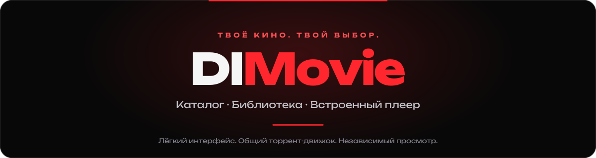
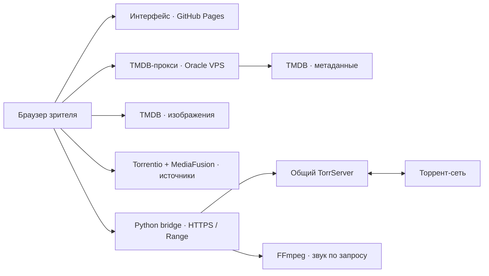

<div align="center">
  
  <br><br>
  <a href="https://geekykrank.github.io/DIMovie/" aria-label="Открыть сайт DIMovie"></a>
  <br><br>
  <a href="https://geekykrank.github.io/DIMovie/"></a>
  <a href="docs/STREAMING.md"></a>
  <a href="https://github.com/GeekyKrank/DIMovie/issues"></a>
  <br><br>
  
  
  
  <a href="LICENSE"></a>
  <p><strong>Находи фильмы, сохраняй в библиотеку и смотри во встроенном плеере.</strong></p>
  <p>Чёрный интерфейс, красные акценты, шрифт Unbounded и минимум зависимостей.</p>
</div>

---

<p align="center">
  <a href="#возможности">Возможности</a> ·
  <a href="#как-смотреть">Как смотреть</a> ·
  <a href="#архитектура">Архитектура</a> ·
  <a href="#лимиты-и-производительность">Лимиты</a> ·
  <a href="#локальный-запуск">Разработка</a> ·
  <a href="#частые-вопросы">Вопросы</a>
</p>

## Возможности

| | Что доступно |
|---|---|
| **Каталог** | Популярные фильмы, лучшие и сейчас в кино; поиск по названию, рейтинги, описания и постеры TMDB. |
| **Аниме** | Каталог AniLiberty, поиск, серии и качество 480p/720p/1080p при наличии у провайдера. Прямой HLS-поток без торрент-пиров. |
| **Библиотека** | Сохранение до 100 фильмов в текущем браузере. Без регистрации; синхронизации между устройствами нет. |
| **Источники** | Поиск по IMDb ID: общий Torrentio, отдельные группы RuTracker/Rutor и Nyaa/аниме, дополнительный MediaFusion. Качество, размер и число раздающих показываются, если источник их передал. |
| **Языковые метки** | Синяя — русский звук, жёлтая — украинский. Это подсказка источника; наличие дорожки подтверждается при открытии файла. |
| **Плеер** | Видео внутри страницы фильма: пауза, перемотка на 10 секунд, шкала времени, громкость и полный экран. |
| **Управление** | Клавиатурные сокращения; скрытие панели во время просмотра и плавное появление в полном экране при движении мыши. |
| **Озвучка** | Выбор доступных дорожек средствами браузера или серверная подготовка звука AAC с сохранением видеодорожки. |
| **Совместный просмотр** | До трёх зрителей, в том числе с разными фильмами. Одна раздача использует общий буфер, позиции просмотра независимы. |

<details>
<summary><strong>Предпросмотр интерфейса</strong></summary>


Внешний вид развивается; изображение может отличаться от последней опубликованной версии.

</details>

## Как смотреть

1. Открой **[DIMovie](https://geekykrank.github.io/DIMovie/)** и найди фильм.
2. Открой его страницу и выбери доступный источник под плеером.
3. Нажми **«Смотреть»** и дождись начального буфера.
4. При необходимости выбери звуковую дорожку в плеере. Сохраняй понравившиеся фильмы в **«Библиотеку»**.

Обычному зрителю не нужны TMDB-токен, пароль сервера или ручной ввод magnet-ссылки. Ручной выбор раздачи остаётся в дополнительных настройках.

| Клавиша | Действие |
|---|---|
| `Пробел` / `K` | Воспроизведение / пауза |
| `←` / `→` | Перемотка назад / вперёд на 10 секунд |
| `F` | Полный экран |
| `M` | Выключить / включить звук |

## Архитектура



**Торрент загружается на VPS, а не в браузере.** GitHub Pages раздаёт только интерфейс. Сервер передаёт видеоданные браузеру потоково, поддерживая HTTP Range и backpressure; в Python фильм целиком не загружается.

- **Frontend:** HTML, CSS и JavaScript ES-модули без UI-фреймворков и runtime npm-зависимостей для каталога фильмов. Для аниме по запросу загружается локальная HLS.js Light 1.7.3 (Apache-2.0; лицензия в `site/vendor/hls-LICENSE.txt`).
- **Метаданные:** TMDB через серверный прокси; токен не входит в публичный сайт. Постеры загружаются напрямую с TMDB.
- **Поиск источников:** четыре ограниченных запроса выполняются с устройства зрителя: общий Torrentio, его группы RuTracker/Rutor и Nyaa/TokyoTosho/AniDex, а также Stremio-дополнение MediaFusion. Прямого входа на RuTracker или отдельного парсера Nyaa нет. Они уже входят в провайдеры Torrentio; отдельные группы помогают не потерять результаты при ограничении выдачи. Одинаковые hash + fileIdx объединяются, языковые метки сохраняются. Итог — до 120 вариантов, до 60 от одного запроса; таймаут 20 секунд, не более 2 МиБ на ответ. Кэш — до 12 фильмов на 5 минут (30 секунд при частичном отказе). Ошибка одного сервиса не отменяет успешные ответы остальных. При недоступности показывается список неответивших групп; сервер не обходит блокировки. MediaFusion может вернуть пустой список; принимаются только совместимые infoHash-источники, без DRM, debrid и внешних ссылок.
- **Видео:** один общий TorrServer и отдельные гостевые сеансы. Одинаковый info hash повторно использует буфер, но у каждого зрителя свои ссылки и перемотка.
- **Аудио:** совместимые файлы передаются напрямую. При серверной смене звука FFmpeg копирует видео и кодирует только аудио в AAC; полного перекодирования видео нет.

## Лимиты и производительность

Текущая конфигурация рассчитана на Oracle Cloud Free VPS с **1 ГБ RAM**.

| Ресурс | Текущий предел |
|---|---|
| Активные зрители | **3 всего** |
| Разные активные раздачи | **До 3** |
| Кэш видео | **64 МиБ RAM на раздачу**, без постоянного дискового видеокэша |
| Память TorrServer | До **448 МиБ**, MemoryHigh **320 МиБ** |
| Python bridge вместе с FFmpeg | До **192 МиБ** |
| Серверная обработка озвучки | **1 процесс FFmpeg одновременно** |
| Передача видео | До **6 HTTP-медиазапросов**; это не число разрешённых зрителей |
| Неактивный буфер | Около **60–90 секунд** при штатной очистке; движок может освободить раньше |

**Что проверено:** в коротком тесте 19 октября 2026 года три разные раздачи передавались примерно по **4 Мбит/с каждая в течение 30 секунд**. Использовались открытые тестовые фильмы, текущий движок и обработчики bridge через SSH-туннель. Это не длительный браузерный тест и не проверка трёх обработчиков озвучки. Четыре и пять разных потоков проверку стабильности не прошли.

Скорость зависит от пиров, битрейта, кодеков, сети и доступных ресурсов VPS. Лимит трёх зрителей не гарантирует отсутствие буферизации у любой раздачи. Каталог остаётся доступным, даже когда все места просмотра заняты.

## Стабильность и безопасность

- Общий кэш по info hash, независимые читатели и защита активных данных от удаления.
- Ограниченные HTTP-потоки, память, процессы и частота запросов; отказ в новых просмотрах при нехватке ресурсов.
- Очистка неактивных сеансов, повтор удаления после ошибок и освобождение ресурсов при отключении клиента.
- Гостевые токены и ссылки просмотра живут ограниченное время; остановка отзывает ссылки данного зрителя.
- Лёгкие приватные снимки ресурсов каждые 30 секунд. Административный интерфейс защищён паролем.
- Пользовательские tracker/webseed-параметры magnet-ссылок удаляются. Внутренние сети и metadata endpoints закрыты для движка через systemd.
- TMDB-токен, пароли и SSH-ключи не должны попадать в репозиторий. Не публикуй личные ссылки просмотра.

Подробнее: **[политика ресурсов, жизненный цикл и мониторинг](docs/STREAMING.md)**.

## Локальный запуск

Нужны **Node.js 22+** для проверок и **Python 3.10+** для backend и простого локального HTTP-сервера.

```bash
git clone https://github.com/GeekyKrank/DIMovie.git
cd DIMovie
npm run check
npm test
python -m unittest discover -s backend -v
python -m http.server 8000 --directory site
```

Открой `http://localhost:8000`. Запуск через `file://` не подходит для ES-модулей. Для работы серверных API с локальной страницей необходимо явно настроить разрешённый localhost Origin; сам запуск статического сервера этого не делает.

<details>
<summary><strong>Структура проекта</strong></summary>

```text
site/
  app.js            Каталог, карточки и библиотека
  api.js            Запросы метаданных и кэш
  sources.js        Источники и языковые подсказки
  player.js         Подключение плеера к странице
  transport.js      Сеанс и транспорт воспроизведения
  controls.js       Управление видео и озвучкой
  audio.js          Метки и выбор дорожек
  style.css         Оформление и адаптивность
  assets/           Логотип и локальные шрифты
backend/
  player_bridge.py  Гостевые API и передача видео
  lifecycle.py      Общие раздачи, владение и очистка
  monitor.py        Ресурсы и защита при перегрузке
  test_*.py         Серверные тесты
  deploy.py         Установка на подготовленный VPS
docs/               Предпросмотр и описание архитектуры
.github/workflows/  Проверки и публикация GitHub Pages
```

</details>

## Развёртывание

**Интерфейс:** workflow GitHub Actions проверяет проект и публикует папку `site/` в GitHub Pages после push в `main`. В настройках Pages источник — **GitHub Actions**.

**Backend:** отдельный Linux VPS с Python, nginx, TorrServer и FFmpeg. Bridge слушает только loopback за HTTPS nginx. Секрет TMDB хранится на сервере, административный доступ не используется посетителями.

При переносе проверь публичные адреса в `site/config.js` и `site/player.js`, CORS backend, конфигурацию TMDB-прокси и nginx. Для видеомаршрута используется `proxy_buffering off`. Скрипт `backend/deploy.py` предназначен для уже подготовленного окружения, а не для универсальной установки на пустую систему.

## Частые вопросы

**Нужна ли регистрация в TMDB каждому зрителю?**

Нет. Метаданные получает серверный прокси с серверным токеном.

**Почему фильм буферизуется?**

Раздача может отдавать данные медленнее битрейта фильма. Выбери меньший файл или источник с большей фактической скоростью; число пиров в описании не гарантирует скорость.

**Можно ли смотреть три разных фильма?**

Да, текущий лимит — три зрителя и до трёх раздач. Четвёртый зритель получает сообщение о занятости.

**Почему нельзя всем одновременно менять озвучку через сервер?**

Подготовка звука требует CPU. На текущем VPS разрешён только один FFmpeg-процесс; прямое воспроизведение совместимых файлов его не использует.

**Где моя библиотека?**

В localStorage текущего браузера. Очистка данных сайта удаляет сохранённый список; на другом устройстве он не появится автоматически.

**Работают ли все форматы и браузеры?**

Нет. Совместимость контейнера, видеокодека и звука зависит от браузера. Серверная подготовка аудио не исправляет неподдерживаемый видеокодек. DRM и платные внешние источники не поддерживаются этим плеером.

**Есть ли скачивание и офлайн-просмотр?**

Полноценный менеджер загрузок и офлайн-режим веб-сайта не заявлены. Текущий буфер временный и не является сохранённой копией фильма.

## Данные, права и лицензия

Данные и изображения предоставлены **[TMDB](https://www.themoviedb.org/)**.

*This product uses the TMDB API but is not endorsed or certified by TMDB.*

GitHub Pages не хранит видео. Используй раздачи, на просмотр и распространение которых у тебя есть права, и соблюдай условия хостинга. Наличие источника в поиске не подтверждает права на контент.

Исходный код — **[MIT](LICENSE)**. Лицензия кода не распространяется автоматически на фильмы, постеры, сторонние данные и товарные знаки. Лицензии локальных шрифтов находятся в `site/assets/fonts/`.

---

<div align="center">
  <strong>DIMovie</strong><br>
  <a href="https://geekykrank.github.io/DIMovie/">Открыть сайт</a> ·
  <a href="https://github.com/GeekyKrank/DIMovie/issues">Предложить улучшение</a> ·
  <a href="docs/STREAMING.md">Техническая документация</a>
</div>

## Прямое аниме через AniLiberty

Кнопка **«Аниме»** вместо «В тренде» открывает отдельный каталог провайдера
(при проверке — около 1900 релизов), с поиском и пагинацией. Это не архив всех
существующих аниме и не гарантия доступности каждого релиза.

[Призрак в доспехах (1995)](https://geekykrank.github.io/DIMovie/?anime=9716)
проверен через настоящий HLS-поток: видеокадры 720p, ход времени и перемотка.
Выбор качества сохраняет позицию. Серии выбираются отдельно.

Метаданные и видео запрашиваются браузером напрямую у AniLiberty/CDN. VPS не
передаёт эти видео, торрентные сеансы и FFmpeg для них не создаются. Ограничения
провайдера по региону и правам соблюдаются; параметры его потоков, в том числе
рекламные, не удаляются. Провайдер может показывать рекламу и менять доступность.

Кэш API ограничен 16 ответами на 2 минуты, размер ответа — 4 МиБ. HLS-библиотека
загружается только при запуске аниме. Её целевой буфер — 30 секунд, задний буфер —
20 секунд; значения не являются жёстким общим лимитом памяти браузера. При выходе
движок HLS уничтожается. Библиотека хранится локально, без runtime-загрузки с CDN.

API: https://anilibria.top/api/docs/v1 . Сохранение аниме в библиотеку и автоматический
переход к следующей серии пока не реализованы.
