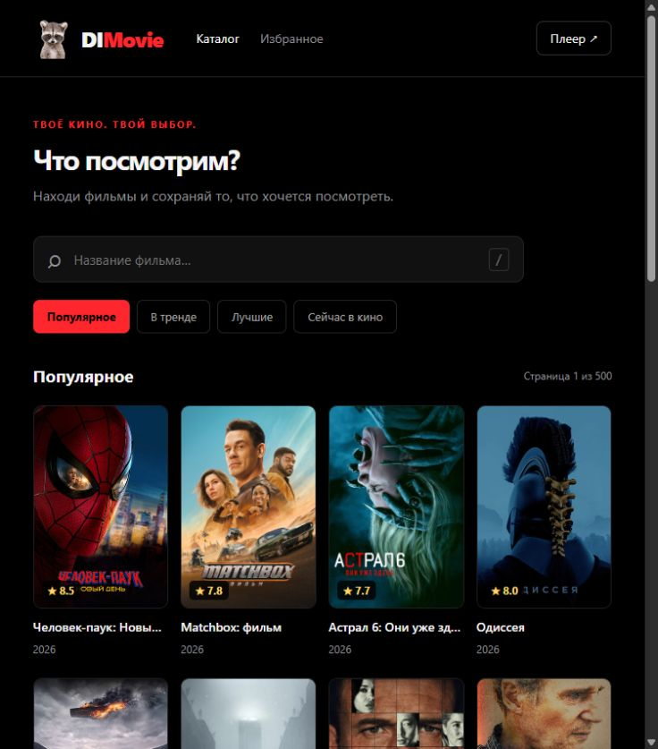

# DIMovie

Лёгкий веб-каталог фильмов с чёрным фоном, красными акцентами и логотипом-енотом.

**Сайт:** https://geekykrank.github.io/DIMovie/

Поиск с задержкой 350 мс и отменой старых запросов, страницы по 20 фильмов,
ограниченный кэш метаданных, ленивые постеры нужного размера, карточка фильма,
избранное в localStorage. Без сторонних JS-фреймворков и runtime-зависимостей.
Избранное хранится в текущем браузере (до 100 фильмов), не синхронизируется между устройствами.

## Размещение

Отдельный публичный репозиторий **DIMovie**, не исходники Android-приложения.
GitHub Pages публикует `site/` через workflow после push в main.
В Settings → Pages выбрать Source: GitHub Actions.
Адрес GitHub Pages обслуживает интерфейс; TMDB и TorrServer работают на Oracle.
Для переезда поменять публичные адреса в `site/config.js` и CORS на backend.

TMDB проксируется сервером, ключ не входит в сайт. Сервер разрешает Origin
`https://geekykrank.github.io`. Постеры приходят напрямую с image.tmdb.org.
HTML5-плеер находится прямо под описанием фильма, без всплывающего окна.
Доступ зрителей открыт без пароля; административная страница TorrServer остаётся закрытой.
Пароли, SSH-ключи и TMDB-токен в этот репозиторий не добавлять.

## Текущее ограничение

Кнопка «Плеер» и кнопка в карточке открывают встроенный плеер DIMovie.
Можно добавить magnet-ссылку, выбрать видеофайл,
смотреть, перематывать и менять громкость. Источники автоматически ищутся по IMDb ID
фильма в Torrentio — тем же Stremio API, которое используется Android-приложением.
Зритель выбирает найденный вариант и нажимает «Смотреть»; magnet вручную не нужен.
Поиск выполняется обычным браузерным запросом с устройства посетителя, поскольку
Oracle получает от дополнения HTTP 403. Нет проксирования или обхода блокировки:
при отказе дополнения на устройстве показывается ошибка. Кэш — 12 фильмов на 5 минут,
не более 60 вариантов на фильм и 2 МиБ ответа, запросы отменяются при смене фильма.
Прямые HTTPS/DRM/внешние платные источники этим торрент-плеером не обрабатываются.
Совместимость аудио/видео зависит от браузера. Oracle Micro имеет 1 ГБ RAM:
одновременно допускаются до трёх зрителей, в том числе разных фильмов. Остальные зрители получают
сообщение «Сервер занят», при этом каталог доступен всем.

Шлюз `backend/player_bridge.py` слушает loopback за HTTPS nginx. Зритель получает
случайный гостевой токен, управляющий только его собственным просмотром. Он живёт
только в памяти страницы; отдельная случайная ссылка видео ограничена выбранным
файлом и 6 часами. Возврат в каталог или остановка отзывает её; свободный буфер сохраняется до 60 секунд. Брошенные сеансы
очищаются после 5 минут без запросов статуса. Разрешены до трёх активных раздач; у зрителей одной раздачи общий буфер.
Поток передаётся порциями 64 КиБ, без загрузки фильма целиком в память Python.
Шлюз вместе с FFmpeg ограничен 192 МиБ RAM, TorrServer — 448 МиБ. Не публикуйте ссылки просмотра.
Гостевые подключения ограничены 4 в минуту на IP и 60 в минуту суммарно,
максимум 64 гостевых сеанса и 6 соединений передачи видео. Внешние URL торрент-файлов
не принимаются, кроме фиксированного открытого тестового Big Buck Bunny.
Magnet очищается до info hash; пользовательские tracker/webseed-параметры не передаются.
Внутренние адреса и облачные metadata endpoints закрываются для TorrServer через systemd.
Для установки скопировать Python-файл в `/opt/dimovie-player`, unit в
`/etc/systemd/system`, настроить `/dimovie-player/` на `127.0.0.1:5091/` с
`proxy_buffering off`, отключить access log, передать X-Real-IP от nginx и включить сервис.
`backend/deploy.py` обновляет уже установленный отдельный DIMovie Micro, не donbot.

Проверки: тесты frontend API и HTTP unit-тесты шлюза; реальный HTTPS
гостевой сеанс, метаданные тестового Big Buck Bunny и 65536 байт видео с HTTP Range 206.
Длительный просмотр и все браузерные кодеки этими проверками не подтверждаются.

## Локальная разработка

Node.js 22+: `npm run check` и `npm test`. Для просмотра запустить любой
статический HTTP-сервер из папки `site/`. Файлы являются ES-модулями:
открытие index.html через file:// не подходит. Для локальных API-запросов
нужно явно добавить localhost Origin в серверную конфигурацию CORS.

Данные и изображения предоставлены [TMDB](https://www.themoviedb.org/).
This product uses the TMDB API but is not endorsed or certified by TMDB.
Видео не хранится на GitHub Pages. Используйте контент, на который у вас есть права.

Лицензия исходного кода — MIT, см. LICENSE. Сторонние данные и изображения
не становятся MIT-материалами из-за публикации этого репозитория.

Подробная политика ресурсов, мониторинг и план безопасного совместного просмотра: [docs/STREAMING.md](docs/STREAMING.md).
